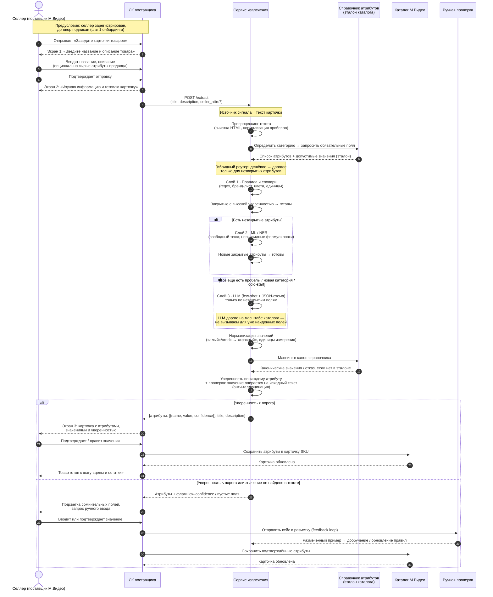

# Диаграмма последовательности: создание карточки товара с автозаполнением атрибутов

Основной сценарий первого чекпоинта: селлер М.Видео в личном кабинете поставщика заводит карточку товара; сервис **извлекает значения из текста карточки**, сверяет их со **справочником каталога** (эталон), нормализует и возвращает характеристики с уверенностью.

Важно:
- **Источник сигнала** — название, описание и сырые атрибуты продавца (не «достаём» значение из каталога).
- **Эталон** — справочник каталога: какие атрибуты обязательны для категории и какие значения каноничны.
- **Гибрид по стоимости** — дешёвые методы закрывают типовые случаи; ML и LLM подключаются только к незакрытым атрибутам.

## Участники

| Участник | Роль |
| --- | --- |
| Селлер | Поставщик маркетплейса М.Видео, создаёт карточку |
| ЛК поставщика | UI личного кабинета (экран ввода → ожидание → результат) |
| Сервис извлечения | Пайплайн: препроцессинг → гибридное извлечение → нормализация → мэппинг |
| Справочник атрибутов | Эталон каталога: обязательные поля категории + допустимые значения |
| Каталог М.Видео | Приём проверенных атрибутов в карточку SKU |
| Ручная проверка | Очередь low-confidence / спорных значений (опционально) |

## Sequence diagram

## Гибридная схема (ответ на требование про стоимость)

| Слой | Что делает | Когда включается | Стоимость |
| --- | --- | --- | --- |
| 1. Правила и словари | Явные паттерны в тексте | Всегда первым | Очень низкая |
| 2. ML / NER | Свободные формулировки | Только незакрытые после слоя 1 | Средняя |
| 3. LLM | Cold-start, новые категории, хвост | Только незакрытые после слоя 2 | Высокая |

Итог: типовые карточки закрываются дёшево; LLM не вызывается «на каждую карточку целиком», а точечно — по полям, где без него не обойтись.

## Вход / выход сервиса (для тест-кейсов)

**Запрос (вход) — текст карточки:**
- `title` — название товара
- `description` — свободный текст описания
- `seller_attrs` (опционально) — атрибуты, которые уже указал продавец

**Эталон (не вход селлера, а внутренний справочник):**
- обязательные атрибуты категории
- допустимые / канонические значения

**Ответ (выход):**
- список объектов `{ attribute, value, confidence }`
- только канонические значения из справочника категории
- без выдуманных характеристик: значение должно опираться на текст карточки

**Пример ответа (смартфон):**

| Атрибут | Значение | Уверенность |
| --- | --- | --- |
| Бренд | Samsung | 0,98 |
| Объём памяти | 256 ГБ | 0,95 |
| Диагональ экрана | 6,7 дюйма | 0,93 |
| Цвет | чёрный | 0,81 |

## Связь с онбордингом поставщика

1. Зарегистрируйтесь и подпишите договор  
2. **Заведите карточки товаров** ← здесь встроен наш сервис  
3. Прогрузите цены и остатки  
